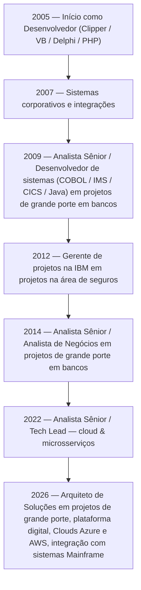

# 🚀 Samuel Mizato — Arquiteto de Soluções & Especialista Backend

**Osasco, São Paulo, Brasil 🇧🇷**  
**<!--experience-years-->21<!--/experience-years--> anos de experiência em engenharia de software e arquitetura corporativa**

Sou Arquiteto de Soluções com trajetória sólida em **Java (Spring Boot)**, **microsserviços**, **cloud**, **integração corporativa** e **plataformas de alta disponibilidade**. Atuo conectando estratégia de negócio com decisões técnicas, garantindo **escalabilidade**, **resiliência**, **observabilidade** e **segurança** em ambientes complexos — especialmente nos setores **financeiro**, **seguros** e **utilities**.

---

## 🧭 Visão Profissional

💡 Transformo requisitos de negócio em soluções arquiteturais robustas  
🔐 Promovo práticas de segurança e governança desde o design  
⚙️ Desenho arquiteturas orientadas a domínio, eventos e microsserviços  
📈 Lidero times técnicos, mentorando desenvolvedores e guiando decisões estratégicas  
☁️ Experiência prática em Azure, AWS e ambientes híbridos  

---

# 🛡️ Tecnologias & Ferramentas

## 🔧 Backend & Linguagens

## ☁️ Cloud & DevOps

## 🔗 Integração & Mensageria

---

# 🗺️ Mapa de Competências

| Área | Nível | Descrição |
|------|-------|-----------|
| **Arquitetura de Soluções** | ⭐⭐⭐⭐⭐ | Microsserviços, DDD, EDA, governança, segurança, escalabilidade |
| **Backend Java** | ⭐⭐⭐⭐⭐ | Spring Boot, APIs REST, integração corporativa |
| **Cloud** | ⭐⭐⭐⭐☆ | Azure, AWS, Kubernetes, pipelines CI/CD |
| **Integração** | ⭐⭐⭐⭐⭐ | Kafka, RabbitMQ, Camel, Mainframe |
| **Liderança Técnica** | ⭐⭐⭐⭐⭐ | Mentoria, revisão de código, decisões arquiteturais |
| **DevSecOps** | ⭐⭐⭐⭐☆ | Segurança, automação, observabilidade |

---

# 🕰️ Linha do Tempo da Carreira

---

# 🎓 Formação & Certificações

🎓 **MBA em Cybersecurity & DevSecOps — FIAP**  
🎓 **Bacharel em Análise de Sistemas — FATEC Ourinhos**

📜 **Certificações:**  
- MongoDB  
- Azure Fundamentals  
- Azure Administrator  
- Lean Startup  

---

# 📊 Estatísticas do GitHub

`https://github-readme-stats.vercel.app/api?username=smizato&show_icons=true&theme=dracula`  
`https://github-readme-stats.vercel.app/api/top-langs/?username=smizato&layout=compact&theme=dracula`

---

# 🌐 Conecte-se

---

<small>*Última atualização: <!--LAST_UPDATED-->17-10-2026 16:18:14<!--LAST_UPDATED-->*

